<p align="center">
  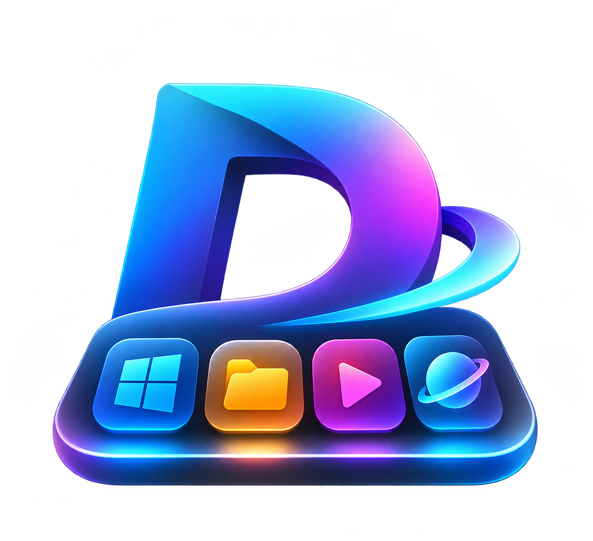
</p>

<h1 align="center">Docksy</h1>

<p align="center">
  <b>A lightweight native taskbar for Windows 11.</b><br>
  Any screen edge, any size. Real tray, Start panel, system monitor. One ~0.5 MB exe, no WebView.
</p>

<p align="center">
  
  
  
  
  
</p>

<p align="center">
  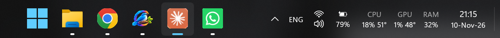
</p>

## Screenshots

<table>
  <tr>
    <td align="center" width="50%">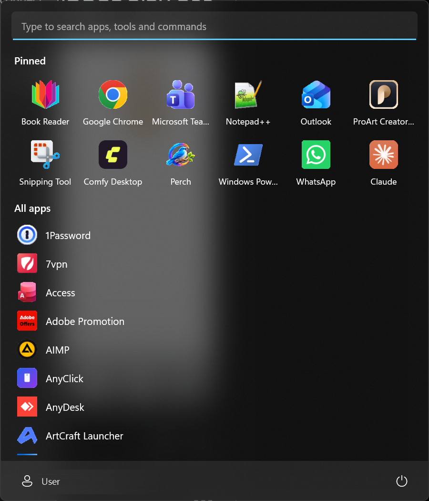<br><sub><b>Start panel</b>: pinned and all apps</sub></td>
    <td align="center" width="50%">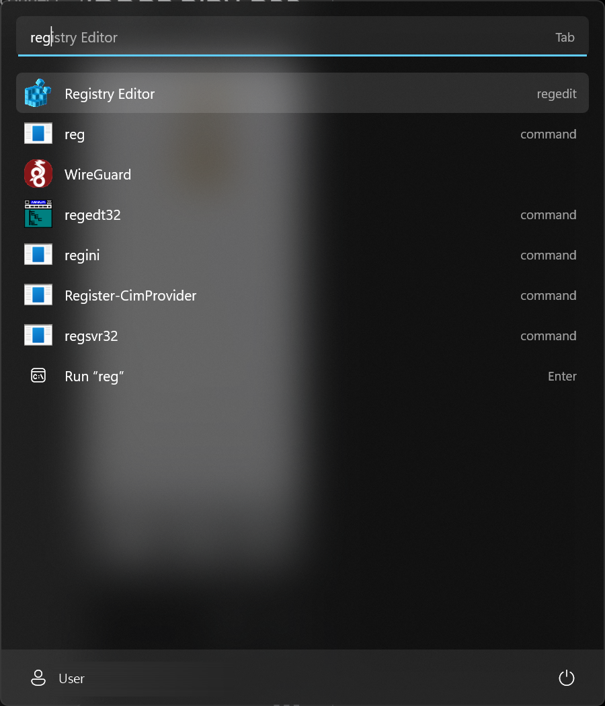<br><sub><b>Search</b>: apps, Windows tools and commands, Tab to complete</sub></td>
  </tr>
  <tr>
    <td align="center">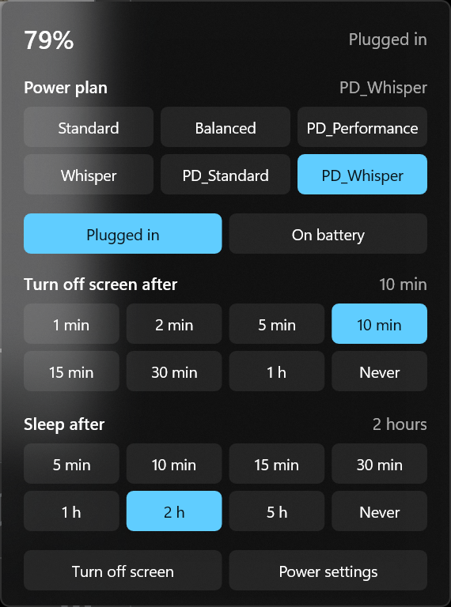<br><sub><b>Power panel</b>: plan, screen-off and sleep timers in one click</sub></td>
    <td align="center">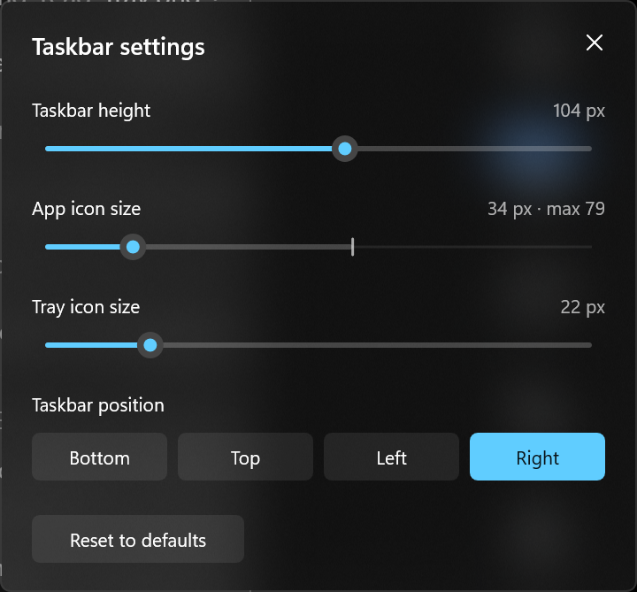<br><sub><b>Taskbar settings</b>: live sliders and position</sub></td>
  </tr>
  <tr>
    <td align="center">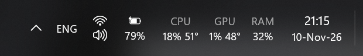<br><sub>Tray, language, Wi-Fi / sound, battery and clock</sub><br><br>
      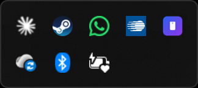<br><sub>Tray overflow</sub><br><br>
      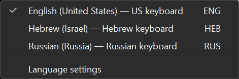<br><sub>Input language switcher</sub><br><br>
      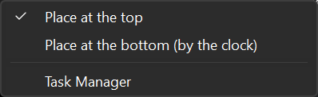<br><sub>Move the CPU / GPU / RAM monitor to either end</sub></td>
    <td align="center">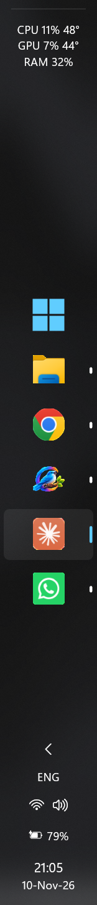
      &nbsp;&nbsp;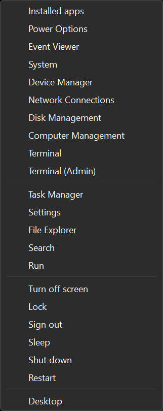<br><sub>Vertical bar &nbsp;·&nbsp; Start button's Win+X menu</sub></td>
  </tr>
</table>

## Features

A lightweight native taskbar for Windows 11, with configurable height and icon size.
Based on [Seelen UI](https://github.com/eythaann/seelen-ui) by eythaann (see *Origin and license*).
Built for ARM64 (Snapdragon / NVIDIA N1X); also builds for x64.

- one small native process (~0.5 MB exe), Direct2D drawing, no WebView
- one bar per monitor; it reserves its screen edge like the real taskbar
- pinned apps (imported from your Windows taskbar on first run) and running apps,
  grouped per app, with focus/attention indicators
- system tray icons: the ones Windows is set to show on the taskbar, the rest behind a
  `^` overflow flyout (right-click menu → "Choose which tray icons show..." opens
  Windows' setting; `tray_show_all = true` shows them all)
- battery with charge percentage (laptops/tablets; `show_battery`). Click it for a power
  panel: switch power plan, power mode (on the Balanced plan), and the screen-off and
  sleep timers for plugged in / on battery in one click
- input language indicator (ENG) for the focused window; click it for the list of
  installed languages to switch to, plus Language settings (`show_language`)
- system monitor next to the clock: CPU / GPU / RAM load and CPU / GPU temperature
  (thermal zones + NVIDIA NVML; other GPUs show load only), hover for details,
  click for Task Manager; right-click to move it to the other end of the bar
  (`show_monitor`, `monitor_side`)
- own Start panel next to the Start button (any bar edge): type to search, your
  pinned apps (right-click an app → Pin to Start; stored in `start_pins.txt`) and
  all apps from Windows' Apps folder. Search also finds the Windows tools (Command Prompt,
  PowerShell, Registry Editor, Services, ...) by name or command (`cmd`, `regedit`),
  programs on the PATH, and runs what you typed like Win+R; Tab completes the top
  match, Ctrl+Shift+Enter (or right-click) runs as administrator. The Win key opens it too (Win+key combinations
  still work; `win_key_opens_start = false` gives the Win key back to Windows' Start).
  Its footer has your account (lock, sign out) and power (sleep, shut down, restart).
- quick-settings button (Win+A), clock with date (Win+N),
  Start button (right-click = Docksy's own copy of the Win+X menu, opened next to
  the button), corner strip that minimizes all windows
  (click again to restore them; on left/right bars it sits in the top corner)

## Install

Download the installer from [Releases](https://github.com/Tanfilov/Docksy/releases/latest):
`Docksy-Setup-<version>-arm64.exe` for ARM64 PCs (Snapdragon, NVIDIA N1X) or
`Docksy-Setup-<version>-x64.exe` for Intel / AMD PCs. Each one only installs on its own
kind of Windows (Settings > System > About > System type tells which you have).

The installer isn't code-signed yet, so Windows SmartScreen may warn about it: click
**More info** → **Run anyway**.

Run it (asks for admin once). It installs to
`C:\Program Files\Docksy`, adds Docksy to the Start menu and, if ticked, starts it when
you sign in. Uninstall from Settings > Apps: it closes Docksy, brings the Windows
taskbar back, and asks whether to keep your settings and pins (`%APPDATA%\Docksy`).

## Build

Needs Rust, plus Visual Studio Build Tools with the **MSVC ARM64** and/or **x64** build
tools. ARM64 is the default target (`.cargo/config.toml`):

```bash
cargo build --release
```

```bash
cargo build --release --target x86_64-pc-windows-msvc
```

Output: `target/<target>/release/docksy.exe` and `docksy_trayhook.dll` (keep both in
the same folder).

## Use

- Run `docksy.exe`. It hides the Windows taskbar while running.
- Right-click empty space on the bar for: **Close Docksy (back to Windows taskbar)**,
  Task Manager, Taskbar settings (position and sizes), which tray icons show,
  Start with Windows, and restart.
- If it ever crashes and the Windows taskbar stays hidden: `docksy.exe --restore`.
- `docksy.exe --dump` writes how pins and windows are detected to the log.

Right-click the bar → **Taskbar settings...** for sliders (taskbar height, app icon
size, tray icon size) that apply live and save on release.

All settings: `%APPDATA%\Docksy\config.toml` (applies on save) — `height`, `icon_size`,
`tray_icon_size`, position, colors, backdrop, clock format.
Pins: `%APPDATA%\Docksy\pins.txt`. Log: `%APPDATA%\Docksy\docksy.log`.

App buttons: click = focus/minimize (several windows: cycle through them),
middle-click = new instance, right-click = window list, pin/unpin, close.

## How the tray works

Explorer keeps owning the real tray (its taskbar is only hidden). `docksy_trayhook.dll`
is hooked into explorer's tray thread (`WH_CALLWNDPROC`) and copies every
`Shell_NotifyIcon` message to Docksy; clicks are forwarded to the owning apps.
The DLL must match explorer's architecture, which is why there are separate ARM64 and
x64 builds (an x64 Docksy can't hook the tray on ARM64 Windows).

## Building the installer

Needs [Inno Setup 6](https://jrsoftware.org/isinfo.php) (`winget install JRSoftware.InnoSetup`).

```powershell
.\build-installer.ps1
```

Output: `installer\Output\Docksy-Setup-<version>-arm64.exe` and `-x64.exe`
(`-Arch arm64` or `-Arch x64` builds just one). The app icon and the
installer's wizard images are generated from `taskbar\assets\logo.png` by
`taskbar\assets\make_icon.py` (needs Pillow).

## Origin and license

Window filtering, pinned-app import, native-taskbar hiding and the tray hook are
ported from [Seelen UI](https://github.com/eythaann/seelen-ui) (AGPL-3.0-or-later),
so this project is AGPL-3.0-or-later as well.

Docksy is an independent project, not affiliated with or endorsed by Seelen UI or its
author. The full license text is in `LICENSE` (also installed next to `docksy.exe`).
